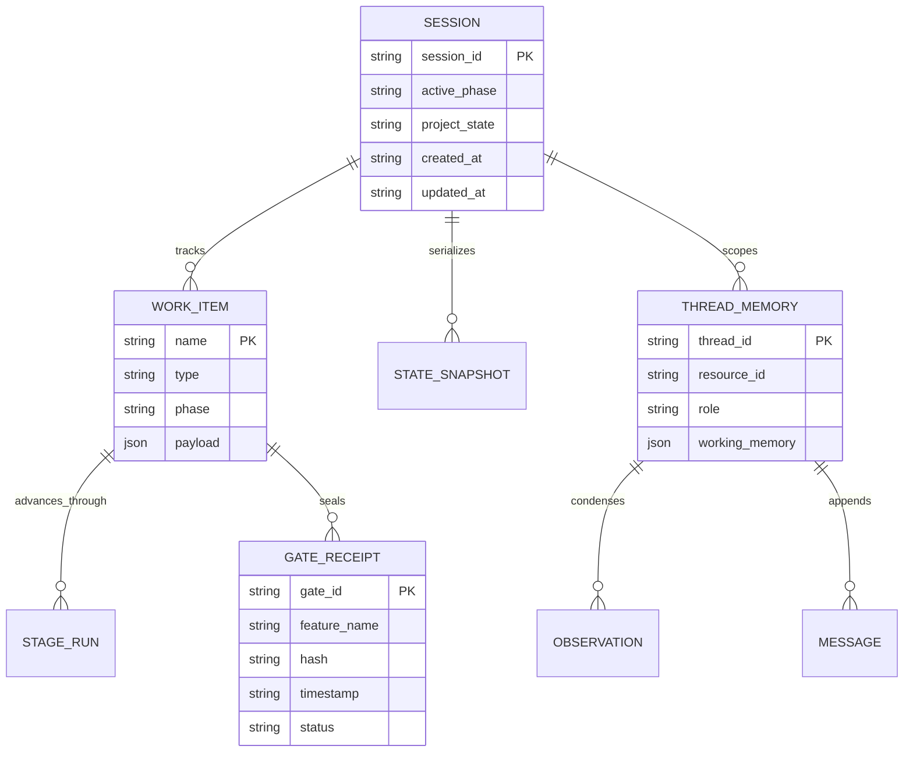

# data and storage specification: dual-engine harness

**document id:** `dat-01-dual_engine_state_and_storage_spec.md`  
**governance gate:** gate 2 (architecture and data specification)  
**status:** accepted & ratified  
**author:** autonomous system architect agent  
**created at:** 2026-11-03t03:45:00z  

---

## 1. overview

this document establishes the canonical data dictionary, entity-relationship structures, and storage lifecycle specifications for the `@sdlc/dual-engine-harness` package. it specifies how state snapshots, review gate receipts, thread memory, and workflow run telemetry are structured, serialized, and persisted to disk without host-side external database daemons.

---

## 2. entity-relationship model

---

## 3. data dictionary & schemas

### 3.1 session state snapshot schema (`.sdlc/state/session-<id>.json`)

persists macro and micro engine state across process boundaries:

| field | type | constraints | description |
| :--- | :--- | :--- | :--- |
| `session_id` | `string` | lowercase alphanumeric, hyphens | unique session identifier preventing path traversal |
| `macro_phase` | `string` | enum (`phase_00_inception` .. `phase_09_continuous_learning`) | current active xstate macro lifecycle phase |
| `project_state` | `string` | enum (`project_inception`, `active_development`, `maintenance`, `retired`) | sovereign project governance state |
| `active_work_item` | `object` \| `null` | nullable | currently executing work item descriptor |
| `active_work_item.name` | `string` | non-empty | work item name (e.g. `hash_verifier`, `mastra_memory_storage`) |
| `active_work_item.type` | `string` | enum (`feature`, `fix`, `hotfix`, `refactor`, `security_patch`, `dependency_upgrade`, `ingest`) | work item routing pathway type |
| `active_work_item.phase` | `string` | non-empty | active micro stage within work item statechart |
| `active_work_item.payload` | `object` | key-value dictionary | contextual inputs, problem statement, and workspace root |
| `active_gate` | `string` \| `null` | nullable enum (`gate_1`, `gate_2`, `gate_3`, `gate_4`) | active review gate under evaluation |
| `timestamp` | `string` | iso 8601 utc | snapshot serialization timestamp |

### 3.2 cryptographic release receipt schema (`.sdlc/receipts/release-<name>.json`)

tamper-evident proof of completed review gates:

| field | type | constraints | description |
| :--- | :--- | :--- | :--- |
| `feature_name` | `string` | non-empty | feature identifier sealed by devops engineer |
| `version` | `string` | semver string (`x.y.z`) | released semantic version increment |
| `gate_id` | `string` | enum (`gate_1`, `gate_2`, `gate_3`, `gate_4`) | evaluated gate identifier |
| `hash` | `string` | sha-256 hex string | cryptographic digest of evaluated artifacts |
| `status` | `string` | literal `'completed'` | execution status |
| `timestamp` | `string` | iso 8601 utc | receipt sealing timestamp |

### 3.3 persistent thread and memory storage (`.sdlc/mastra/`)

governed by mastra filesystem store:

| path pattern | format | entity | purpose |
| :--- | :--- | :--- | :--- |
| `.sdlc/mastra/threads/<thread_id>.json` | json | `ThreadRecord` | thread metadata partitioned by work item id |
| `.sdlc/mastra/messages/<thread_id>.json` | json array | `MessageRecord` | sequential multi-turn conversational dialogue |
| `.sdlc/mastra/working_memory/<thread_id>.json` | json | `WorkingMemoryRecord` | structured scratchpad for active requirements and file paths |

---

## 4. data lifecycle & retention policies

1. **immutability of receipts**:
   - release receipts in `.sdlc/receipts/` are append-only. existing receipts are never updated in place.
2. **snapshot atomicity**:
   - session snapshots are serialized atomically using temporary swap writes or sync writes to avoid corrupt snapshots on unexpected process termination.
3. **path sanitisation**:
   - all session and work item identifiers are strictly validated against `/^[a-z0-9_-]+$/` to eliminate directory traversal risks.
